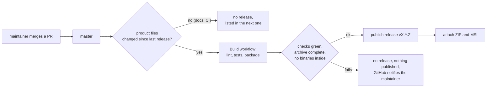

# Releasing Feature Heist

Feature Heist is released on GitHub with two assets per release:

| Asset | Content |
|---|---|
| `FeatureHeist-X.Y.Z-scripts.zip` | the extract, install and uninstall scripts with README, LICENSE and NOTICE, for manual use |
| `FeatureHeist-X.Y.Z.msi` | everything needed to install and uninstall (once its source exists) |

The migration script from other LBFO installations (`tools/`) is in neither asset; it is only
available from the repository. Changes to it alone do not produce a release.

Versions follow [Semantic Versioning](https://semver.org) (0.x before 1.0). **Every merge into
`master` that changes the product is a release**, that is changes to `src` (scripts and installer
source) or `build` (packaging script). Merges that only touch documentation, tests, `tools` or CI build
nothing new; they are listed in the next real release. There is no manual release step: merging a pull
request is the approval.

No Microsoft files are part of any release; they are extracted from the user's own Windows Server
media on the target machine.

## Workflows at a glance

| Workflow | File | Trigger | What it does |
|---|---|---|---|
| **Build** | `build.yml` | PR to `master`, push to `master` | Lint (parser, ASCII check, PSScriptAnalyzer), tests (Pester) and the package build. On `master`, if the product changed since the last release, it builds the release assets with the new version, publishes the release `vX.Y.Z` and attaches the assets. |
| **Release Drafter** | `release-drafter.yml` | PR events, push to `master` | Labels pull requests from their Conventional Commit titles and keeps the release notes of the next version up to date. |

All actions are pinned to a commit SHA (with the version as a comment). There are no scheduled runs and
no automatic dependency updates: whenever a workflow is changed, its actions and the WiX version are
raised to the latest release by hand.

## Release flow

1. A change is merged into `master` through a PR (feature branch, squash merge).
2. The Build workflow runs lint and tests and builds the package.
3. The **package check** verifies that the ZIP contains every product script, no repo-only script and
   no binary (no `.sys`, `.cat`,
   `.mum`, `.cab`, images or executables). If any check fails, there is no release.
4. On success the release `vX.Y.Z` is published with notes generated from the merged pull requests and
   the assets `FeatureHeist-X.Y.Z-scripts.zip` and `FeatureHeist-X.Y.Z.msi` are attached. Tag, release
   and assets always belong to the same commit.

## Version numbers

The next version follows from the labels of the merged pull requests:

| Labels | Version step |
|---|---|
| `breaking`, `major` | major |
| `feature`, `enhancement` | minor |
| anything else (`fix`, `docs`, `chore`, no label) | patch |

Labels are set automatically from Conventional Commit titles (`feat:`, `fix:`, `docs:`, ...).

## Rollback

Releases are never rebuilt. Install the assets of an earlier release instead; uninstalling with the
current version and installing the older one is supported, because uninstalling does not need the
extracted files.
